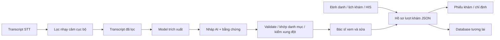

# Task 2 — Cấu trúc dữ liệu khám ngoại trú TMH

Ngày: 12/11/2026. Phạm vi người dùng đã chọn: **ngoại trú Tai Mũi Họng trước**.

Phạm vi task 2, 3 và 4 chỉ gồm **phiếu khám và chỉ định dịch vụ**. **Bác sĩ tự kê đơn thuốc qua quy trình riêng**; cấu trúc lưu, đầu ra AI và mapping trong bộ thiết kế này không chứa đơn thuốc. Dị ứng và thuốc bệnh nhân đang dùng vẫn thuộc bệnh sử/tiền sử. Hướng điều trị và lời dặn chỉ ghi nội dung chăm sóc, theo dõi, tái khám; không chứa tên thuốc kê mới, liều dùng hoặc nội dung đơn thuốc.

Đây là bộ thiết kế dữ liệu và JSON mẫu cho prototype. Hồ sơ Encounter và đầu ra AI dùng `2.0.0` (CardioNote, Tim mạch); transcript và identity giữ `1.1.0`. Hồ sơ TMH `1.x` bị từ chối khi đọc với thông báo "Hồ sơ TMH cũ (schema 1.x) không dùng được cho CardioNote.", không chuyển đổi và không ghi lại. Bảng phủ trường Excel nằm ở `src/shared/clinical/excel-coverage.ts` (49 trường, 41 cột). Các schema đã được nối vào validator, API, trích xuất AI, hai màn hình và lưu JSON. Xem [hướng dẫn vận hành](../CLINICAL-WORKFLOW.md). Không có dữ liệu bệnh nhân thật trong ví dụ. Transcript mẫu có cả lời nhắc kê thuốc để minh họa việc bỏ qua nội dung này trong đầu ra.

## Đọc bộ tài liệu theo thứ tự

1. Tài liệu này: phạm vi, mô hình, quy tắc, database tương lai và kế hoạch.
2. [Bảng ánh xạ trường](field-mapping.md): trường trên hai màn → JSON → nơi được phép lấy dữ liệu.
3. [Hợp đồng AI](ai-contract.md): transcript đã lọc → trích xuất → kiểm tra → bản nháp chờ bác sĩ.
4. Các file [schema](../../config/clinical/) và [ví dụ](examples/).

| File | Vai trò |
|---|---|
| `config/clinical/identity.schema.json` | Kho định danh hạn chế truy cập: bệnh nhân, bác sĩ, thẻ bảo hiểm; không gửi model |
| `config/clinical/encounter.schema.json` | Bản ghi lưu trữ một lượt khám, gồm phiếu, chẩn đoán, kết quả, chỉ định, nguồn và audit |
| `config/clinical/transcript.schema.json` | Đầu vào đã xử lý riêng tư, có đoạn hội thoại và vai trò người nói nếu đã xác minh |
| `config/clinical/ai-output.schema.json` | Đầu ra trích xuất của model; không có mã danh mục, giá, ID hệ thống hay quyền duyệt |
| `config/clinical/common.schema.json` | Định nghĩa dùng chung; mỗi object đóng với `additionalProperties: false` |
| `examples/transcript.example.json` | Hội thoại giả, vai trò do người dùng gán, không giả định diarization đã tốt |
| `examples/ai-output.example.json` | Đầu ra tương ứng, kèm bằng chứng |
| `examples/encounter.example.json` | Bản nháp lưu trữ tương ứng; chưa được bác sĩ duyệt |
| `examples/identity.example.json` | Alias giả, minh họa nối dữ liệu bằng ID |
| `examples/*-unknown-speaker.example.json` | Hội thoại chưa xác minh người nói, không biến lời xin thuốc thành đơn |
| `examples/*-service.example.json` | Chỉ định có nhóm; bỏ qua lời kê thuốc trong transcript |

Kiểm tra bộ thiết kế bằng `python docs/task-2/verify.py` (cần Python với `jsonschema >= 4`). Script kiểm schema, ví dụ, pointer/quote/vai trò bằng chứng và một số payload sai. Đây không phải validator nghiệp vụ của ứng dụng.

JSON Schema sử dụng Draft 2020-12. Các `$ref` tương đối được giải quyết từ thư mục `config/clinical/`. Khi tích hợp structured output phải biên dịch về tập tính năng nhà cung cấp hỗ trợ; không mặc định gửi nguyên schema liên file cho mọi model.

## 1. Hiểu lại danh sách task

| Task | Xử lý theo yêu cầu hiện tại |
|---|---|
| 1a. Phân tách giọng chưa tốt | Tạm hoãn, không sửa trong đợt này |
| 1b. Thu âm thực tế để kiểm STT | Người dùng lấy file và cung cấp sau; thiết kế không phụ thuộc việc đã có file |
| 2. Cấu trúc dữ liệu JSON | Trọng tâm đợt này: tổng hợp phiếu khám và chỉ định dịch vụ, cấu trúc lưu, cấu trúc AI, mapping và kế hoạch |
| 3. Tóm tắt, chuyển transcript sang cấu trúc | Chỉ trích xuất phiếu khám và chỉ định dịch vụ; không trích xuất hoặc điền đơn thuốc |
| 4. Hiển thị lên từng màn | Chỉ mapping phiếu khám và chỉ định dịch vụ; chưa thay giao diện |
| 5. Lọc thông tin nhạy cảm | Về luồng chạy phải đứng trước task 3; hiện chỉ thiết kế ranh giới, chưa có bộ lọc được triển khai |

File `docs/tasks.txt` và các ghi chép là tài liệu tham khảo; các ý tưởng như tự gợi ý điều trị, tự tích BHYT, cải tiến tìm kiếm không tự động trở thành yêu cầu triển khai trong đợt này.

## 2. Căn cứ và khoảng trống hiện tại

Đã đối chiếu ba tài liệu cấu trúc màn ngày 09/11, ghi nhận tuần 2 và phản hồi bác sĩ ngày 11/11 với `config/forms/*.json`, `src/shared/eform/types.ts`, `src/shared/eform/dien-phieu.ts`, `src/server/ai/schema.ts`, `src/server/ai/pipeline.ts`, hai tab chỉ định/kê đơn và hợp đồng STT.

Hiện có hai hình thức dữ liệu khác nhau:

- Schema AI sinh từ config chỉ có 10 trường phiếu khám, 4 trường chỉ định và 10 trường kê đơn. Model chỉ được điền tên/nội dung; server khớp mã và tính tổng.
- eForm có nhiều trường hơn, còn sinh hiệu, lịch sử và kết quả được cấp từ `CaGia`. `Draft = Record<string, Values | Values[]>` chưa diễn tả quan hệ database, giai đoạn chẩn đoán, nhiều nhóm chỉ định hoặc trạng thái duyệt chi tiết.

`data/sessions/` hiện lưu **lượt thử/metrics**, không phải hồ sơ khám chính thức. Không dùng lại schema đó làm hồ sơ lâm sàng. Mapping hiện tại còn dùng một chẩn đoán chính cho cả ban đầu và ra viện; mô hình mới giữ hai giai đoạn riêng. Chưa có câu kết luận ra viện thì không tự sao chép chẩn đoán ban đầu sang.

## 3. Cách tiếp cận đề xuất

| Cách | Lợi ích | Đánh đổi |
|---|---|---|
| Giữ JSON theo các ô UI hiện tại | Ít thay đổi ban đầu | Mã, tên và trạng thái trộn lẫn; thiếu quan hệ, khó giữ nhiều đợt chỉ định |
| Dùng FHIR đầy đủ ngay | Có cấu trúc trao đổi chuẩn | Tăng đáng kể khối lượng profile, terminology, validation cho prototype |
| **Mô hình nghiệp vụ riêng, tham khảo FHIR** | JSON dễ đọc, quan hệ rõ, chuyển database và viết adapter sau được | Chưa phải payload FHIR; khi tích hợp phải làm mapping riêng |

Tài liệu này cụ thể hóa **phương án thứ ba do người thực hiện đề xuất**, chưa ghi nhận người dùng đã duyệt phương án hay giao diện tích hợp. Dùng key `snake_case` không dấu, nội dung hiển thị tiếng Việt, giữ các key cũ khi nghĩa phù hợp.

Tham khảo mô hình: chỉ định là yêu cầu thực hiện, kết quả là bản ghi riêng và nguồn dữ liệu gắn với phiên bản. Đây là lựa chọn thiết kế dựa trên [ServiceRequest](https://hl7.org/fhir/R4/servicerequest.html) và [Provenance](https://hl7.org/fhir/R4/provenance.html), không phải tuyên bố tuân thủ FHIR.

## 4. Bốn lớp dữ liệu



**Định danh:** lưu họ tên, ngày sinh, địa chỉ, số giấy tờ, liên lạc, người đại diện, thông tin bác sĩ và thẻ bảo hiểm riêng. UI ghép theo ID bằng backend có quyền. Model không nhận đối tượng này hoặc ID bệnh nhân/bác sĩ thật.

**Hồ sơ lượt khám:** một aggregate JSON có ID ổn định. Mỗi chỉ định và chẩn đoán có ID riêng. `chan_doan[]` ở cấp hồ sơ là nguồn chuẩn duy nhất cho chẩn đoán; `phieu_kham` bản lưu không lặp lại chẩn đoán. Chẩn đoán tách `giai_doan=ban_dau/ra_vien/chua_ro` và `vai_tro=chinh/kem_theo/chua_ro`, để một chẩn đoán kèm vẫn thuộc được giai đoạn cụ thể. `chi_dinh.groups[]` giữ thông tin chung từng lần chỉ định, mỗi dòng liên kết bằng `group_id`. `ai_runs` lưu thông tin lần trích xuất, không trộn với dữ liệu bác sĩ đã duyệt.

**Transcript đã lọc:** giữ các đoạn đã hoàn tất với `id`, `sequence`, thời điểm nếu có và vai trò. Có thể nhận một đoạn text duy nhất; không bắt buộc biết người nói. Mã `utterance_ref` phải là token opaque, không phải đường dẫn ghi âm chứa thông tin cá nhân.

**Nháp AI:** chứa `tom_tat`, `phieu_kham`, `chi_dinh`, `bang_chung`, `can_xem_lai`. Cùng tên và kiểu trường lâm sàng với hồ sơ lưu, nhưng không được tạo ID, mã dịch vụ/ICD, giá, số tiền BHYT hoặc quyền phê duyệt.

## 5. Quy tắc lưu trữ

### Giá trị trống và phủ định

- `null`: chưa có dữ kiện; không thay bằng `0`, chuỗi rỗng hay `false`.
- `false`: có dữ kiện phủ định rõ. Ví dụ không có thuốc đang dùng, không hẹn tái khám.
- `[]`: không có phần tử đã ghi nhận. Với chỉ định phải đọc thêm `de_cap`: `chua_de_cap` khác `khong_chi_dinh`.
- Dị ứng có bốn trạng thái: chưa đề cập, có, không, không xác định. “Không rõ có dị ứng” không được thành “Không”.
- Không bỏ thông tin phủ định, bên cơ thể, thời gian và số liệu khi tóm tắt. Tiền sử gia đình **liên quan bệnh** được giữ; chuyện gia đình ngoài khám bị loại trước khi gửi AI.

### Số liệu và thời gian

- Số liệu dùng JSON number. Đại lượng gồm `{value, unit}`; số đã có phải có đơn vị được xác minh, không đoán đơn vị từ số trần.
- Đơn vị chuẩn nội bộ: `kg`, `cm`, `Cel`, `mm[Hg]`, `%`, `/min`, `kg/m2`, `m2`, `mL/min`; thời gian dùng `ngay`, `tuan`, `thang`, `gio`. Nhãn in do UI chuyển sang tiếng Việt. Đây là quy ước nội bộ, không tuyên bố mọi đơn vị đều là UCUM.
- `quantity` tổng quát cho kết quả cho phép số 0/âm khi nguồn có giá trị đó; `positiveQuantity` dùng cho khoảng thời gian phải dương. Số lượng dịch vụ có ràng buộc dương riêng. Không áp ràng buộc số lượng vào mọi kết quả xét nghiệm.
- Thời điểm hệ thống dùng ISO 8601 có offset, ngày dùng `YYYY-MM-DD`. Thời gian tái khám chưa đủ căn cứ chuyển thành ngày cụ thể được giữ nguyên văn. Không suy ngày dựa trên đồng hồ lúc AI chạy.
- Hẹn “sau một tháng” giữ đơn vị tháng; tính theo lịch khi đã có thời gian khám. Không mặc định một tháng bằng 30 ngày.
- Giá lưu số nguyên VND. Không có giá là `null`; không phải miễn phí. Checkbox BHYT và kết luận đủ điều kiện thanh toán là hai trường khác nhau. Không tự quyết mức hưởng hoặc số tiền bảo hiểm.

### Bệnh sử dùng thuốc và chỉ định

- `thuoc_dang_dung[]` chỉ chứa thuốc đã/đang dùng trước quyết định điều trị hiện tại. Không ghi thuốc kê mới, đổi liều hoặc lệnh ngừng thuốc hôm nay vào đây. Kê đơn, đổi/ngừng thuốc, tính liều và cấp phát do bác sĩ xử lý riêng, ngoài task 2, 3, 4.
- Dịch vụ nói chung chung giữ tên nguyên văn và chưa khớp mã. Không dùng tiền tố mã để đoán khoa; không tự thêm xét nghiệm theo chẩn đoán. Gói chỉ định lưu `package_id`/version/group nhưng từng dịch vụ vẫn có dòng ID riêng; không tự mở rộng gói trước khi xác nhận nội dung gói.
- Chỉ định đã có chưa đồng nghĩa đã làm. Kết quả nằm trong `ket_qua[]`, liên kết `service_order_id` khi biết; kết quả ngoài viện có thể chưa có order ID.
- Trạng thái chỉ định và trạng thái lượt khám độc lập. AI không tự xác nhận, hủy chỉ định hoặc chuyển trạng thái khám.

### Nguồn, duyệt và phiên bản

- `schema_version` là phiên bản hợp đồng; `revision` là phiên bản hồ sơ. ID server tạo, tên file không lấy từ transcript.
- `nguon_du_lieu[]` lưu nguồn theo JSON Pointer của **hồ sơ lưu**, liên kết `ai_run_id` và vị trí bằng chứng trong artifact AI gốc. Chỉ số bằng chứng chỉ có nghĩa bên trong artifact bất biến đó.
- `review.trang_thai` khác `status` nghiệp vụ. Khi bác sĩ sửa, lưu lịch sử thay đổi, giữ output AI ban đầu bất biến, đánh dấu dữ liệu mới là `nhap_tay`; không sửa bằng chứng để hợp thức hóa nội dung mới.
- Chạy AI lại tạo run mới. Chỉ đề xuất thay đổi trên đúng revision gốc; không ghi đè trường bác sĩ sửa. Chẩn đoán và dịch vụ mới luôn cần bác sĩ duyệt.
- Lưu nháp được phép thiếu trường; xác nhận/in phải qua validation nghiệp vụ ở backend và người có quyền. `approved_at/by` không lấy từ client/model. Đổi trường sau duyệt làm mất hiệu lực duyệt của revision mới.

## 6. Chuyển từ JSON sang database

Prototype đề xuất lưu mỗi lượt khám thành một file, tách khỏi `data/sessions/` đang dùng cho metrics:

```text
data/clinical/encounters/<server-generated-id>.json
data/clinical/ai-runs/<server-generated-run-id>.json
data/clinical/transcripts/<opaque-transcript-id>-r<revision>.json
data/private/identities/<server-generated-id>.json
```

Đây là **đường dẫn đề xuất, chưa được tạo để chứa dữ liệu thật**. Khi triển khai phải đưa các thư mục này ra khỏi Git, kiểm quyền backend, không phục vụ như static public, tách log và không lưu transcript raw mặc định. JSON ghi bằng file tạm cùng thư mục rồi rename, kiểm revision trước khi ghi. Cách này dành cho một instance; nhiều process cần khóa/coordinator hoặc database.

| Bảng tương lai | Khóa và quan hệ | Dữ liệu chính |
|---|---|---|
| `patients` | `id` PK | Định danh và người đại diện, quyền truy cập riêng |
| `practitioners`, `facilities`, `departments`, `locations` | `id` PK | Danh tính nhân viên, cơ sở, khoa, phòng/giường |
| `appointments` | `id` PK, `patient_id` FK | Lịch hẹn và lý do khám; lấy từ luồng lịch khám khi triển khai |
| `encounters` | `id` PK, patient/appointment/facility FK, revision | Thời điểm, trạng thái, bác sĩ, tuổi tại khám, tóm tắt |
| `clinical_notes` | encounter FK, revision | Nội dung phiếu khám; nhóm trường ổn định là cột, chi tiết chuyên khoa có thể JSONB |
| `observations` | `id` PK, encounter FK | Sinh hiệu, giá trị, đơn vị, thời điểm và nguồn |
| `diagnoses` | `id` PK, encounter FK | Giai đoạn, mức khẳng định, mã hệ thống ICD và version, mô tả bác sĩ |
| `history_entries` | `id` PK, patient/encounter FK | Tiền sử, dị ứng, bản ghi gốc được copy; không ghi đè lịch sử bằng lời hôm nay |
| `service_order_groups` | `id` PK, encounter FK | Lần chỉ định/gói; chẩn đoán hoặc lịch sử lâm sàng chung |
| `service_orders` | `id` PK, group/encounter/catalog FK | Dịch vụ, số lượng, vị trí/bên, trạng thái, gói nguồn |
| `service_order_diagnoses` | order FK + diagnosis FK | Quan hệ nhiều–nhiều lý do chỉ định |
| `diagnostic_results` | `id` PK, encounter/order FK | Kết quả, nhóm, thời điểm và hệ thống nguồn |
| `service_catalog`, `order_packages`, `package_items` | `id` PK, version | Danh mục nội bộ; tách mã bệnh viện, mã tham khảo và snapshot nội dung |
| `coverages`, `order_billing` | patient/order FK | Thẻ/quyền lợi và đánh giá thanh toán từng dòng |
| `transcripts`, `transcript_segments`, `ai_runs` | encounter FK; run → transcript revision | Nội dung đã lọc, model/prompt/schema version, trạng thái chạy; request opaque được backend nối encounter |
| `field_provenance`, `review_events`, `audit_events` | entity ID + revision + field path | Dẫn chứng, người sửa/duyệt, thời điểm và phiên bản trước/sau |

Không dùng mã dịch vụ làm PK vì có nhiều code system/version. Tham chiếu FK và snapshot tên cùng tồn tại: cập nhật danh mục không làm đổi chỉ định cũ. Định danh ở kho hạn chế; bản nháp AI không được chứa tên, số thẻ, số điện thoại thật.

Lộ trình database: trước hết có thể lưu aggregate nguyên vẹn trong JSONB kèm ID/revision, sau đó chuyển nhóm cần truy vấn sang bảng; giữ adapter đọc/ghi cùng contract. Không cần đổi đầu ra AI chỉ vì đổi nơi lưu.

## 7. Kế hoạch triển khai tiếp nối

Task 2 ở đợt này tạo cấu trúc và bộ thiết kế có thể xem xét. Các bước A–G bên dưới đã được triển khai ở mức prototype; bước H chờ file ghi âm thực tế:

| Thứ tự | Việc | Tiêu chí nghiệm thu |
|---|---|---|
| A | Chốt cấu trúc, đối chiếu các ô chưa quan sát rõ với bác sĩ | Tất cả trường đã biết có mapping; mục chưa biết được ghi rõ, không bịa trường bắt buộc |
| B | Thêm validator và kiểu TypeScript từ hợp đồng | Reject khóa lạ, sai kiểu, enum; thêm validation quan hệ/đơn vị/duyệt ngoài JSON Schema |
| C | Repository lưu JSON và API đọc/lưu nháp | ID server tạo, revision chống ghi đè, ghi file nguyên tử, tách clinical khỏi metrics, chặn truy cập hồ sơ không có quyền |
| D | Làm bộ lọc task 5 tối thiểu trước task 3 | Pending/blocked không ra model; không log raw; test tên, liên lạc, giấy tờ, bảo hiểm, chuyện ngoài khám; giữ dữ kiện y khoa cần thiết |
| E | Adapter STT + model trích xuất task 3 | Nhận transcript final, kiểm schema và bằng chứng; người nói chưa rõ tạo cờ; AI retry không sinh chỉ định trùng |
| F | Adapter UI task 4 + duyệt | Điền đúng hai màn phiếu khám/chỉ định, dữ liệu chưa nhắc để trống, không ghi đè ô bác sĩ sửa, không tự khớp mã khi nhiều ứng viên |
| G | Tích hợp review/submit/in | Chỉ in snapshot đã duyệt, kiểm trường bắt buộc, trạng thái và nguồn, không xác nhận chỉ định chưa xác định đúng dịch vụ |
| H | Sau khi người dùng cung cấp ghi âm thật | Đánh giá STT và độ đúng từng trường bằng nhãn bác sĩ; phân tách giọng vẫn là hạng mục cải tiến riêng |

Các điểm bắt buộc thử khi triển khai: không có chỉ định; thuốc đang dùng khác thuốc kê mới; bỏ qua lời kê thuốc dù do bác sĩ nói; không lách đơn thuốc qua tóm tắt/hướng điều trị/lời dặn; người nói không rõ; câu phủ định; sửa số lượng/vị trí chỉ định; hẹn theo tháng; giá không có; checkbox BHYT chưa rõ; model lặp output; sửa sau duyệt; kết quả CLS chưa về.

## 8. Điểm còn phải xác minh, không cản thiết kế ban đầu

- Mã thứ hai cạnh PID là mã gì; OH/ViHC cụ thể là hệ thống nào; quyền đọc/ghi API thực tế.
- Checkbox BHYT là đề nghị, xác nhận điều kiện hay thao tác khác; phòng BHYT cung cấp quy tắc nào. `chon_bhyt` và `dieu_kien_bhyt` giữ riêng tới khi biết rõ.
- Trường con khi có thuốc đang dùng, hẹn tái khám; phần cuối phiếu bị cắt. Những trường bổ sung trong schema là đề xuất, không phải khẳng định màn thật có.
- Gói chọn cả khối có cho bỏ từng dịch vụ không; lịch sử ViHC có trường gì. Không tự tạo cấu trúc chi tiết từ tên tab.
- Quy trình bác sĩ tự kê và in đơn thuốc nằm ngoài bộ thiết kế này; không thiết kế database hoặc adapter cho quy trình đó trong task 2, 3, 4.

## 9. Nguồn nghiên cứu bên ngoài

Tra cứu ngày 12/11/2026, dùng để thiết kế trường dữ liệu; chưa thực hiện kiểm định tuân thủ hoặc thiết lập quy tắc kê đơn/chi trả.

- [FHIR R4 ServiceRequest](https://hl7.org/fhir/R4/servicerequest.html): tham khảo quan hệ chỉ định–lượt khám–kết quả và một dòng cho một dịch vụ.
- [FHIR R4 Provenance](https://hl7.org/fhir/R4/provenance.html): tham khảo nguồn và tác nhân tạo/sửa dữ liệu.

Nguồn nghiệp vụ trong scope là `docs/cau-truc-phieu-kham-ngoai-tru.md`, `docs/cau-truc-man-chi-dinh-dich-vu.md` và bác sĩ xác minh. Tài liệu màn kê đơn được giữ làm tư liệu lịch sử ngoài scope. Các ghi chép BHYT cũ trong repo là giả thuyết nghiên cứu, không được dùng làm luật thanh toán tự động.
