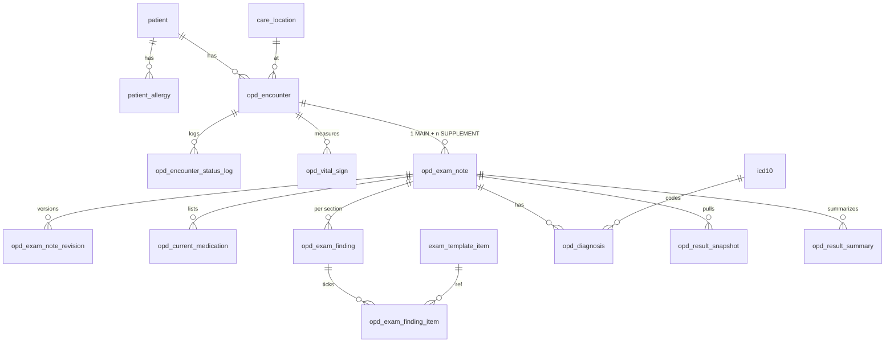

# Vinmec EMR – Phiếu khám ngoại trú (OPD) – Tổng hợp màn hình & Schema DB (v2)

- **Nguồn:** 8 ảnh chụp màn hình `emr.vinmec.com/#/opd/OutpatientExaminationNote/{uuid}` – Trung tâm Tim mạch, Times City (OPD). Chưa đọc được 2 ảnh HEIC (IMG_2782, IMG_2785).
- **Dialect:** PostgreSQL 14+ (chưa chạy thử trên DB thật)
- **Nhãn chú thích:**
  - **[SEEN]**: thấy trực tiếp trên màn hình
  - **[ASSUME]**: suy luận hoặc đề xuất, cần xác nhận
  - **(BCYT)**: field "Hiển thị trên báo cáo y tế"
- **Lưu ý bảo mật:** ảnh gốc có họ tên và PID bệnh nhân thật. Không dùng làm dữ liệu test và che đi trước khi chia sẻ.

## Mục lục
1. Phạm vi & mức độ bao phủ
2. Từ điển dữ liệu (theo màn hình)
3. Sơ đồ quan hệ (ERD)
4. Quyết định thiết kế
5. Ràng buộc nghiệp vụ
6. Màn hình cần chụp thêm (checklist)
7. Câu hỏi cần xác nhận
8. Thay đổi so với v1
9. Schema SQL đầy đủ

---

## 1. Phạm vi & mức độ bao phủ

| Khối | Mức độ bao phủ | Ghi chú |
|---|---|---|
| Header / banner bệnh nhân | Đủ | Chưa có chi tiết popup Dị ứng |
| Lý do khám / Bệnh sử / Tiền sử | **Chưa có ảnh** | Khung [ASSUME] |
| Sinh hiệu dạng số | **Chưa có ảnh** | Khung [ASSUME]. Trên ảnh chỉ có câu "Nhiệt độ, mạch, huyết áp bình thường" |
| Thuốc đang dùng | Có ô Có/Không | Chưa có danh sách thuốc |
| Khám lâm sàng (4 mục) | Đủ | Mới có thư viện của mục Tim mạch – hô hấp và Toàn thân |
| Chẩn đoán (ban đầu / ra viện / kèm theo / OH) | Đủ | |
| Kết quả CLS | Có cấu trúc khối | Chưa thấy nội dung chi tiết của một kết quả |
| 2. Điều trị | Một phần | Field "…người bệnh ra viện" bị cắt khỏi ảnh |
| 3. Thông tin khác | Đủ | |
| Thanh trạng thái / nút thao tác | Đủ | |
| **Ngoài phạm vi phiếu này** | Kê đơn, Chỉ định CLS, Báo cáo y tế, Xem LSKB | Nhiều khả năng là màn hình riêng |

---

## 2. Từ điển dữ liệu

**Giải thích các cột:**
- **Bắt buộc:** Y = có, N = không, C = có điều kiện (xem mục 5)
- **Ai nhập:** BS = bác sĩ, ĐD = điều dưỡng, HT = hệ thống tự điền
- **Nguồn:** hệ thống lưu bản gốc của dữ liệu
- **BCYT:** field có in ra Báo cáo y tế
- **Nhãn:** [SEEN] cho field thấy trên màn hình. Các cột Bắt buộc / Mặc định / Ai nhập / Nguồn hiện **đều là đề xuất [ASSUME]**, cần xác nhận với IT.

### 2.1 Header – Bệnh nhân & Lượt khám
| Field (UI) | Bảng.cột | Kiểu | Bắt buộc | Mặc định | Ai nhập | Nguồn | BCYT | Nhãn |
|---|---|---|---|---|---|---|---|---|
| PID | `patient.pid` | VARCHAR(20) | Y | – | HT | HIS | Y | SEEN |
| Số trong ngoặc sau PID | `opd_encounter.encounter_no` | VARCHAR(20) | Y | – | HT | HIS | ? | SEEN (ý nghĩa ASSUME) |
| Họ tên | `patient.full_name` | TEXT | Y | – | HT | HIS | Y | SEEN |
| Giới tính | `patient.gender` | ENUM NAM/NU/KHAC | Y | – | HT | HIS | Y | SEEN |
| Cờ Dị ứng | `patient.has_allergy` | BOOLEAN | Y | FALSE | HT | EMR | ? | SEEN |
| Chi tiết dị ứng | `patient_allergy.*` | bảng | N | – | BS/ĐD | EMR | ? | ASSUME |
| Cơ sở / Đơn vị | `care_location.site/unit` | TEXT | Y | theo phiên đăng nhập | HT | HIS | Y | SEEN |
| Ngày khám | `opd_encounter.visit_date` | DATE | Y | ngày hiện tại | HT | HIS | Y | ASSUME |

### 2.2 Lý do khám, Bệnh sử, Tiền sử *(chưa có ảnh)*
| Field (UI) | Bảng.cột | Kiểu | Bắt buộc | Ai nhập | Nguồn | BCYT | Nhãn |
|---|---|---|---|---|---|---|---|
| Lý do khám | `opd_exam_finding` (CHIEF_COMPLAINT) | TEXT | Y | BS | EMR | Y | ASSUME |
| Bệnh sử | `opd_exam_finding` (HPI) | TEXT | N | BS | EMR | Y | ASSUME |
| Tiền sử bản thân | `opd_exam_finding` (PAST_HISTORY) | TEXT | N | BS | EMR | Y | ASSUME |
| Tiền sử gia đình | `opd_exam_finding` (FAMILY_HISTORY) | TEXT | N | BS | EMR | ? | ASSUME |

### 2.3 Sinh hiệu *(chưa có ảnh)*
| Field | Bảng.cột | Kiểu | Khoảng hợp lệ | Ai nhập | Nguồn | Nhãn |
|---|---|---|---|---|---|---|
| Mạch | `opd_vital_sign.pulse_bpm` | SMALLINT | 20–250 lần/phút | ĐD | MANUAL / OMRON | ASSUME |
| HA tâm thu / tâm trương | `sbp_mmhg` / `dbp_mmhg` | SMALLINT | 50–300 / 20–200, tâm thu > tâm trương | ĐD | MANUAL / OMRON | ASSUME |
| Nhiệt độ | `temperature_c` | NUMERIC(4,1) | 30–45 °C | ĐD | MANUAL | ASSUME |
| Nhịp thở | `resp_rate` | SMALLINT | 5–60 | ĐD | MANUAL | ASSUME |
| SpO2 | `spo2_pct` | SMALLINT | 50–100 % | ĐD | MANUAL | ASSUME |
| Cân nặng / Chiều cao | `weight_kg` / `height_cm` | NUMERIC(5,1) | 1–400 kg / 30–250 cm | ĐD | MANUAL | ASSUME |
| BMI | `bmi` | tính tự động | – | HT | – | ASSUME |

### 2.4 Thuốc hiện đang dùng
| Field (UI) | Bảng.cột | Kiểu | Bắt buộc | Mặc định | Ai nhập | BCYT | Nhãn |
|---|---|---|---|---|---|---|---|
| NB không có / có thuốc đang dùng | `opd_exam_note.has_current_medication` | BOOLEAN | Y | NULL (chưa hỏi) | BS | ? | SEEN |
| Tên thuốc, liều, tần suất, kê đơn/không | `opd_current_medication.*` | bảng | C (khi = Có) | – | BS | ? | ASSUME |

### 2.5 Khám lâm sàng (BCYT)
Mỗi mục gồm: ô text tự do (`opd_exam_finding.free_text`) và các mục tick từ "Mở thư viện tham khảo" (`opd_exam_finding_item`).

| Field (UI) | section | Bắt buộc | Mặc định | Ai nhập | BCYT | Nhãn |
|---|---|---|---|---|---|---|
| Khám toàn thân | GENERAL | Y | các câu mẫu điền sẵn | BS | Y | SEEN |
| Khám chuyên khoa | SPECIALTY | N | – | BS | Y | SEEN |
| Khám tim mạch, hô hấp | CARDIO_RESP | Y (Tim mạch) | – | BS | Y | SEEN |
| Khám các bộ phận khác | OTHER_ORGANS | N | – | BS | Y | SEEN |

**Thư viện "Khám tim mạch, hô hấp"** (popup có Chọn tất cả / Hủy / Chọn) [SEEN]:
1. Lồng ngực cân đối hai bên
2. Mỏm tim đập ở liên sườn V, giữa đòn trái, tĩnh mạch cổ không nổi
3. Diện đục của tim không to, không rung miu
4. Tiếng T1, T2 đều rõ, không âm thổi
5. Không có tiếng tim bệnh lý
6. Mạch quay đều, rõ
7. Không tím môi, đầu chi
8. Lồng ngực cân đối di động theo nhịp thở
9. Không khó thở, không co kéo cơ hô hấp phụ
10. Rung thanh đều hai bên
11. Gõ trong
12. Phổi trong, không ran
13. Rì rào phế nang êm dịu hai phế trường

**Thư viện "Khám toàn thân"** (các dòng điền sẵn) [SEEN]:
1. Tỉnh táo, tiếp xúc tốt
2. Thể trạng trung bình
3. Da và tổ chức dưới da: màu sắc bình thường, không phù, không dấu xuất huyết
4. Niêm mạc hồng
5. Lông, tóc, móng bình thường
6. Hạch ngoại vi không sưng đau, không sờ thấy tuyến giáp
7. Nhiệt độ, mạch, huyết áp bình thường

### 2.6 Chẩn đoán (`opd_diagnosis`)
| Field (UI) | role | Kiểu | Bắt buộc | Số lượng | Ai nhập | Nguồn | BCYT | Nhãn |
|---|---|---|---|---|---|---|---|---|
| Chẩn đoán ban đầu: ICD-10 + diễn giải | INITIAL | VARCHAR(10) + TEXT | Y | 1 | BS | EMR | ? | SEEN |
| Thông tin chẩn đoán xác định từ OH | OH_CONFIRMED | VARCHAR + TEXT | N | 0..n | HT (bấm "Lấy kết quả mới nhất") | OH | ? | SEEN |
| Chẩn đoán ra viện: ICD-10 + diễn giải | DISCHARGE | VARCHAR(10) + TEXT | C (khi Hoàn thành khám) | 1 | BS | EMR | ? | SEEN |
| Chẩn đoán kèm theo (chọn nhiều, autocomplete ICD) | SECONDARY | VARCHAR(10) | N | 0..n, không trùng mã | BS | EMR | Y | SEEN |

### 2.7 Các xét nghiệm, thăm dò chính (BCYT)
| Field (UI) | Bảng | kind | Ai nhập | Nguồn | Nhãn |
|---|---|---|---|---|---|
| Kết quả xét nghiệm (nhóm theo ngày) | `opd_result_snapshot` | LAB | HT | LIS | SEEN |
| Kết quả chẩn đoán hình ảnh | `opd_result_snapshot` | IMAGING | HT | PACS | SEEN (nguồn ASSUME) |
| Kết quả cận lâm sàng | `opd_result_snapshot` | PARACLINICAL | HT | MUSE / khác | SEEN (nguồn ASSUME) |
| Ô ghi chú dưới mỗi khối (VD "chưa có") | `opd_result_summary` | theo khối | BS | EMR | SEEN |

### 2.8 Đã xử lý & 2. Điều trị
| Field (UI) | Bảng.cột | Kiểu | Bắt buộc | Mặc định | Ai nhập | BCYT | Nhãn |
|---|---|---|---|---|---|---|---|
| Đã xử lý (thuốc, chăm sóc) | `opd_exam_note.treated_at_visit` | BOOLEAN | Y | FALSE ("Không") | BS | ? | SEEN |
| Hướng điều trị | `opd_exam_finding` (TREATMENT_PLAN) | TEXT + thư viện | Y | – | BS | Y | SEEN |
| Lời dặn & theo dõi | `opd_exam_finding` (ADVICE_FOLLOWUP) | TEXT + thư viện | N | – | BS | Y | SEEN |
| Hẹn tái khám Có/Không | `opd_exam_note.followup_scheduled` | BOOLEAN | Y | – | BS | ? | SEEN |
| Ngày tái khám | `opd_exam_note.followup_date` | DATE | C | – | BS | Y | ASSUME |
| "…người bệnh ra viện" | `opd_exam_note.discharge_condition` | TEXT | ? | – | BS | ? | ASSUME |

### 2.9 3. Thông tin khác
| Field (UI) | Bảng.cột | Kiểu | Bắt buộc | Mặc định | Ai nhập | Nhãn |
|---|---|---|---|---|---|---|
| Bác sĩ chính | `opd_encounter.primary_doctor` | VARCHAR(50) | Y | người tạo phiếu | HT | SEEN |
| Bác sĩ được ủy quyền khám (+ nút Chỉnh sửa ủy quyền) | `opd_encounter.delegated_doctor` | VARCHAR(50) | N | N/A | BS | SEEN |
| Chuyển Nội Soi | `opd_exam_note.endoscopy_transfer` | BOOLEAN | Y | FALSE | BS | SEEN |
| Xác nhận bệnh tật | `opd_exam_note.confirm_illness` | BOOLEAN | Y | ? | BS | SEEN |
| Xác nhận nghỉ việc hưởng BHXH | `opd_exam_note.confirm_si_sick_leave` | BOOLEAN | Y | FALSE | BS | SEEN |
| Mã biểu mẫu (VD `A01_251_211222_V`) | `opd_exam_note.form_code` | VARCHAR(30) | Y | theo phiên bản form | HT | SEEN |
| Chỉnh sửa lần cuối bởi … lúc … | `last_edited_by` / `last_edited_at` | VARCHAR / TIMESTAMPTZ | Y | – | HT | SEEN |

### 2.10 Trạng thái & Audit
| Khái niệm | Bảng.cột | Giá trị | Nhãn |
|---|---|---|---|
| Trạng thái **lượt khám** (thanh nút cuối màn hình) | `opd_encounter.status` | Đang khám · Chờ KQ CLS · Hoàn thành khám · Nhập nội trú · Chuyển cấp cứu · Chuyển CSKCB BHYT · Không khám | SEEN |
| Lịch sử chuyển trạng thái | `opd_encounter_status_log` | from → to, ai, lúc nào | ASSUME |
| Trạng thái **phiếu** | `opd_exam_note.state` | DRAFT · SUBMITTED · AMENDED | SEEN (URL) / ASSUME |
| Loại phiếu | `opd_exam_note.note_type` | MAIN · SUPPLEMENT | ASSUME |
| Lịch sử chỉnh sửa | `opd_exam_note_revision` | snapshot JSONB mỗi lần Lưu, field thay đổi, lý do khi sửa phiếu đã submit | ASSUME |
| Xóa mềm | `is_deleted`, `deleted_by`, `deleted_at` | – | ASSUME |
| Nút thao tác | – | Quay lại · Báo cáo y tế · In ngay · Lưu (không lưu DB) | SEEN |

---

## 3. Sơ đồ quan hệ (ERD)



---

## 4. Quyết định thiết kế

| # | Quyết định | Lý do |
|---|---|---|
| 1 | Lưu cả text tự do và các mục tick từ thư viện | Phần khám có dữ liệu cấu trúc dùng ngay cho AI và phân tích, không phải chạy NLP để tách lại *[Gợi ý mở rộng ngoài tài liệu]* |
| 2 | Một bảng `opd_diagnosis` cho mọi loại chẩn đoán, kể cả từ OH | Ô "Ra viện" đang chứa thêm bệnh kèm theo trong phần text, trùng với ô Kèm theo. Gộp một bảng giúp phát hiện và đo mức trùng lặp |
| 3 | Lưu bản chụp kết quả CLS dạng JSONB | Kết quả chỉ kéo về khi bấm nút, nên cần giữ nội dung đúng thời điểm khám |
| 4 | Tách trạng thái **phiếu** khỏi trạng thái **lượt khám** | "Đã submit phiếu" và "Hoàn thành khám" là hai khái niệm khác nhau |
| 5 | Phiếu chính / phiếu bổ sung, mỗi lượt khám chỉ 1 phiếu chính còn hiệu lực | Có cơ chế BS ủy quyền nên có thể phát sinh phiếu bổ sung |
| 6 | Bảng revision lưu snapshot | Audit trail cho JCI và pháp lý hồ sơ bệnh án; hiện chỉ lưu người/lúc sửa cuối |
| 7 | Sinh hiệu là bảng riêng gắn với lượt khám, có cột nguồn (MANUAL/OMRON) | ĐD đo trước khi BS khám; dữ liệu số cần cho các bài toán AI Tim mạch |
| 8 | Xóa mềm thay vì xóa thật | Hồ sơ y tế không được mất dữ liệu |

---

## 5. Ràng buộc nghiệp vụ *(đề xuất – cần xác nhận)*

| # | Ràng buộc | Cài đặt |
|---|---|---|
| R1 | Có ngày tái khám thì phải chọn Hẹn tái khám = Có | CHECK `ck_followup_date` |
| R2 | Phiếu đã submit phải có thời điểm submit | CHECK `ck_submitted_at` |
| R3 | Sửa phiếu đã submit (AMEND) phải ghi lý do | CHECK trên `opd_exam_note_revision` |
| R4 | Mỗi lượt khám có 1 phiếu chính còn hiệu lực | UNIQUE INDEX `ux_note_main_per_encounter` |
| R5 | Mỗi phiếu có 1 chẩn đoán ban đầu và 1 chẩn đoán ra viện | UNIQUE INDEX `ux_dx_single_role` |
| R6 | Chẩn đoán kèm theo không trùng mã | UNIQUE INDEX `ux_dx_secondary_no_dup` |
| R7 | Chẩn đoán phải có mã ICD hoặc diễn giải | CHECK trên `opd_diagnosis` |
| R8 | Chọn "NB có thuốc đang dùng" thì phải có ít nhất 1 thuốc | Kiểm tra ở tầng ứng dụng (không làm được bằng CHECK) |
| R9 | Chuyển trạng thái "Hoàn thành khám" thì phải có chẩn đoán ra viện | Kiểm tra ở tầng ứng dụng |
| R10 | Sinh hiệu nằm trong khoảng hợp lệ, HA tâm thu > tâm trương | CHECK trên `opd_vital_sign` |
| R11 | BS ủy quyền khác BS chính | CHECK trên `opd_encounter` |

---

## 6. Màn hình cần chụp thêm (checklist)

- [ ] Phần **đầu form**: lý do khám, bệnh sử, tiền sử (cuộn lên trên cùng)
- [ ] Khu vực nhập **sinh hiệu** (nếu có ở màn hình ĐD hoặc màn hình khác)
- [ ] Popup **Dị ứng (i)**
- [ ] Danh sách khi chọn **"NB có thuốc đang dùng"**
- [ ] Nội dung mở rộng của **một kết quả XN / CĐHA / CLS** (bấm vào thanh ngày)
- [ ] Thư viện tham khảo của **Khám chuyên khoa, Hướng điều trị, Lời dặn & theo dõi**
- [ ] Khi chọn **Hẹn tái khám = Có**, và field **"…người bệnh ra viện"** đầy đủ
- [ ] Popup **Chỉnh sửa ủy quyền khám**
- [ ] Màn hình **Báo cáo y tế** (để xác nhận field nào được in)
- [ ] **Xem LSKB**, menu **Mở rộng**, ý nghĩa **badge số cạnh tên BS**
- [ ] (Ngoài phạm vi) Kê đơn, Chỉ định CLS, danh sách BN chờ khám (OPD danh sách BN)
- [ ] Gửi lại 2 ảnh HEIC dưới dạng JPG/PNG

---

## 7. Câu hỏi cần xác nhận

**Với IT / Data**
1. Số trong ngoặc sau PID là mã lượt khám, mã hồ sơ hay mã khác?
2. Một lượt khám có thể có nhiều phiếu không (phiếu bổ sung, BS ủy quyền)?
3. "Submitted" trên URL khác "Hoàn thành khám" như thế nào? Sau khi submit có sửa được không, và có lưu lịch sử sửa không?
4. "OH" là hệ thống nào? Khi nào khối "Chẩn đoán xác định từ OH" có dữ liệu?
5. Trong DB thật, thư viện tham khảo có lưu các mục đã tick không, hay chỉ ghép thành text?
6. Dữ liệu MUSE (ECG) và OMRON (huyết áp) đã nối vào EMR chưa? Kết quả CĐHA lấy từ PACS nào?
7. Những field nào là bắt buộc trên hệ thống thật? Field nào in ra Báo cáo y tế?

**Với Bác sĩ / Điều dưỡng**
8. "Chẩn đoán ra viện" trong ngoại trú thực chất là chẩn đoán xác định cuối lượt khám phải không?
9. Lần gần nhất anh/chị ghi bệnh kèm theo vào ô text của Chẩn đoán ra viện thay vì ô Kèm theo, lý do là gì? *(hỏi theo hành vi đã xảy ra, đúng tinh thần Mom Test)*
10. Sinh hiệu được đo và nhập ở đâu, ai nhập? Lần khám gần nhất BS xem số HA ở màn hình nào?

---

## 8. Thay đổi so với v1

| Hạng mục | v1 | v2 |
|---|---|---|
| Sinh hiệu | Không có | Bảng `opd_vital_sign` có khoảng hợp lệ và BMI tự tính |
| Lý do khám / Bệnh sử / Tiền sử | Không có | 4 giá trị mới trong `exam_section` |
| Audit | Chỉ lưu người/lúc sửa cuối | `opd_exam_note_revision` + xóa mềm |
| Phiếu – Lượt khám | Không ràng buộc | `note_type` + unique 1 phiếu chính |
| Trạng thái | `is_submitted` trùng ý với `status` | `note_state` tách riêng |
| Chẩn đoán từ OH | Nằm trong `result_kind` | Chuyển sang `opd_diagnosis` (role OH_CONFIRMED) |
| Cờ BCYT | Không có | `opd_exam_finding.show_on_report` + cột BCYT trong từ điển |
| Từ điển dữ liệu | Chỉ có field + bảng | Thêm Bắt buộc, Mặc định, Ai nhập, Nguồn, BCYT |
| Ràng buộc | 1 unique index | 11 ràng buộc (mục 5) |

---

## 9. Schema SQL đầy đủ

```sql
-- =====================================================================
-- VINMEC EMR – PHIẾU KHÁM NGOẠI TRÚ (OutpatientExaminationNote) – v2
-- Trung tâm Tim mạch – Times City (OPD)
-- Nguồn: 8 ảnh chụp màn hình emr.vinmec.com/#/opd/OutpatientExaminationNote/{uuid}
-- Dialect: PostgreSQL 14+ (chưa chạy thử trên DB thật)
--
-- Quy ước chú thích:
--   [SEEN]    : field nhìn thấy trực tiếp trên màn hình
--   [ASSUME]  : suy luận / đề xuất thiết kế, CẦN XÁC NHẬN với IT/Bác sĩ
--   (BCYT)    : field có nhãn "Hiển thị trên báo cáo y tế"
-- KHÔNG dùng dữ liệu bệnh nhân thật (PID, họ tên) làm seed/test data.
--
-- Thay đổi so với v1:
--   + Sinh hiệu dạng số (opd_vital_sign) [ASSUME]
--   + Lý do khám / Bệnh sử / Tiền sử bản thân / Tiền sử gia đình [ASSUME]
--   + Lịch sử chỉnh sửa (opd_exam_note_revision) – audit trail đầy đủ
--   + Phân biệt phiếu chính / phiếu bổ sung (note_type) + unique phiếu chính
--   + Tách trạng thái phiếu (note_state) khỏi trạng thái lượt khám
--   + "Chẩn đoán xác định từ OH" chuyển sang opd_diagnosis (role OH_CONFIRMED)
--   + Soft delete, CHECK constraint, cờ in BCYT cho từng mục khám
-- =====================================================================

-- ---------------------------------------------------------------------
-- 0. ENUM / DANH MỤC
-- ---------------------------------------------------------------------

-- Trạng thái LƯỢT KHÁM – thanh nút cuối màn hình [SEEN]
CREATE TYPE opd_encounter_status AS ENUM (
  'DANG_KHAM',          -- Đang khám
  'CHO_KQ_CLS',         -- Chờ KQ CLS (cũng là điều kiện để khu nội soi tiếp nhận BN)
  'HOAN_THANH_KHAM',    -- Hoàn thành khám
  'NHAP_NOI_TRU',       -- Nhập nội trú
  'CHUYEN_CAP_CUU',     -- Chuyển cấp cứu
  'CHUYEN_CSKCB_BHYT',  -- Chuyển CSKCB BHYT
  'KHONG_KHAM'          -- Không khám
);

-- Trạng thái PHIẾU (tài liệu) – tách khỏi trạng thái lượt khám.
-- URL "?submited=submitted" [SEEN]; ý nghĩa chính xác [ASSUME]
CREATE TYPE note_state AS ENUM ('DRAFT', 'SUBMITTED', 'AMENDED');

-- Phiếu chính / phiếu bổ sung (BS ủy quyền, bổ sung sau) [ASSUME]
CREATE TYPE note_type AS ENUM ('MAIN', 'SUPPLEMENT');

CREATE TYPE gender_code AS ENUM ('NAM', 'NU', 'KHAC');   -- badge Nam/Nữ [SEEN]

-- Vai trò chẩn đoán
--  INITIAL      : Chẩn đoán ban đầu [SEEN]
--  DISCHARGE    : "Chẩn đoán ra viện" [SEEN] – cần BS xác nhận có = chẩn đoán xác định?
--  SECONDARY    : Chẩn đoán kèm theo (BCYT) [SEEN]
--  OH_CONFIRMED : Thông tin chẩn đoán xác định từ OH [SEEN] – kéo từ hệ thống ngoài
CREATE TYPE diagnosis_role AS ENUM ('INITIAL', 'DISCHARGE', 'SECONDARY', 'OH_CONFIRMED');

-- Khối kết quả CLS [SEEN]
CREATE TYPE result_kind AS ENUM ('LAB', 'IMAGING', 'PARACLINICAL');

-- Các mục nhập text (+ thư viện tham khảo)
CREATE TYPE exam_section AS ENUM (
  'CHIEF_COMPLAINT',    -- Lý do khám            [ASSUME – chưa chụp]
  'HPI',                -- Bệnh sử               [ASSUME – chưa chụp]
  'PAST_HISTORY',       -- Tiền sử bản thân      [ASSUME – chưa chụp]
  'FAMILY_HISTORY',     -- Tiền sử gia đình      [ASSUME – chưa chụp]
  'GENERAL',            -- Khám toàn thân        [SEEN] (BCYT)
  'SPECIALTY',          -- Khám chuyên khoa      [SEEN] (BCYT)
  'CARDIO_RESP',        -- Khám tim mạch, hô hấp [SEEN] (BCYT)
  'OTHER_ORGANS',       -- Khám các bộ phận khác [SEEN] (BCYT)
  'TREATMENT_PLAN',     -- Hướng điều trị        [SEEN] (BCYT)
  'ADVICE_FOLLOWUP'     -- Lời dặn & theo dõi    [SEEN] (BCYT)
);

CREATE TYPE data_source AS ENUM ('MANUAL', 'EMR_AUTO', 'HIS', 'LIS', 'PACS', 'MUSE', 'OMRON', 'OH');

-- Danh mục ICD-10 (autocomplete: gõ "e1" -> E10.1, E11.1...) [SEEN]
CREATE TABLE icd10 (
  code        VARCHAR(10) PRIMARY KEY,      -- VD: I10, E78.0, E10.9
  name_vi     TEXT NOT NULL,
  name_en     TEXT,
  is_active   BOOLEAN NOT NULL DEFAULT TRUE
);

-- ---------------------------------------------------------------------
-- 1. BỆNH NHÂN, NHÂN SỰ, LƯỢT KHÁM
-- ---------------------------------------------------------------------

CREATE TABLE patient (
  pid           VARCHAR(20) PRIMARY KEY,         -- "PID: xxxxxxxxx" [SEEN]
  full_name     TEXT NOT NULL,                   -- [SEEN]
  gender        gender_code NOT NULL,            -- [SEEN]
  date_of_birth DATE,                            -- [ASSUME] không hiện trên banner
  has_allergy   BOOLEAN NOT NULL DEFAULT FALSE   -- badge đỏ "Dị ứng (i)" [SEEN]
);

-- Chi tiết dị ứng – popup (i) chưa chụp [ASSUME]
CREATE TABLE patient_allergy (
  id          BIGSERIAL PRIMARY KEY,
  pid         VARCHAR(20) NOT NULL REFERENCES patient(pid),
  allergen    TEXT NOT NULL,
  reaction    TEXT,
  severity    VARCHAR(20),
  recorded_by VARCHAR(50),
  recorded_at TIMESTAMPTZ NOT NULL DEFAULT now(),
  is_deleted  BOOLEAN NOT NULL DEFAULT FALSE
);

CREATE TABLE staff_user (
  username    VARCHAR(50) PRIMARY KEY,   -- tài khoản trong mục "Bác sĩ chính" [SEEN]
  full_name   TEXT,                      -- tên hiển thị góc phải header [SEEN]
  role        VARCHAR(30)                -- [ASSUME] BS / ĐD / KTV ...
);

CREATE TABLE care_location (
  id          SERIAL PRIMARY KEY,
  site        TEXT NOT NULL,             -- "Times City" [SEEN]
  unit        TEXT NOT NULL              -- "OPD - Trung tâm Tim mạch" [SEEN]
);

-- Số trong ngoặc sau PID, VD "(3621833)" – [ASSUME] mã lượt khám
CREATE TABLE opd_encounter (
  encounter_no        VARCHAR(20) PRIMARY KEY,
  pid                 VARCHAR(20) NOT NULL REFERENCES patient(pid),
  location_id         INT NOT NULL REFERENCES care_location(id),
  status              opd_encounter_status NOT NULL DEFAULT 'DANG_KHAM',
  primary_doctor      VARCHAR(50) REFERENCES staff_user(username),   -- "Bác sĩ chính" [SEEN]
  delegated_doctor    VARCHAR(50) REFERENCES staff_user(username),   -- "Bác sĩ được ủy quyền khám" [SEEN]
  visit_date          DATE NOT NULL,                                  -- [ASSUME]
  CHECK (delegated_doctor IS NULL OR delegated_doctor <> primary_doctor)
);

-- Lịch sử chuyển trạng thái lượt khám (đo thời gian chờ CLS, throughput) [ASSUME]
CREATE TABLE opd_encounter_status_log (
  id            BIGSERIAL PRIMARY KEY,
  encounter_no  VARCHAR(20) NOT NULL REFERENCES opd_encounter(encounter_no),
  from_status   opd_encounter_status,
  to_status     opd_encounter_status NOT NULL,
  changed_by    VARCHAR(50) REFERENCES staff_user(username),
  changed_at    TIMESTAMPTZ NOT NULL DEFAULT now()
);

-- ---------------------------------------------------------------------
-- 2. PHIẾU KHÁM NGOẠI TRÚ
-- ---------------------------------------------------------------------

CREATE TABLE opd_exam_note (
  note_id                   UUID PRIMARY KEY,                -- UUID trên URL [SEEN]
  encounter_no              VARCHAR(20) NOT NULL REFERENCES opd_encounter(encounter_no),
  note_type                 note_type NOT NULL DEFAULT 'MAIN',   -- [ASSUME]
  state                     note_state NOT NULL DEFAULT 'DRAFT', -- [SEEN qua URL] / [ASSUME]
  form_code                 VARCHAR(30) NOT NULL,            -- VD "A01_251_211222_V" [SEEN]

  -- Thuốc hiện đang dùng (kê đơn + không kê đơn): toggle Có/Không [SEEN]
  has_current_medication    BOOLEAN,

  -- Đã xử lý (thuốc, chăm sóc): Không/Có [SEEN]
  treated_at_visit          BOOLEAN NOT NULL DEFAULT FALSE,

  -- 2. Điều trị
  followup_scheduled        BOOLEAN,                         -- "Hẹn tái khám: Có/Không" [SEEN]
  followup_date             DATE,                            -- [ASSUME]
  discharge_condition       TEXT,                            -- "...người bệnh ra viện" (bị cắt) [ASSUME]

  -- 3. Thông tin khác [SEEN]
  endoscopy_transfer        BOOLEAN NOT NULL DEFAULT FALSE,  -- "Chuyển Nội Soi"
  confirm_illness           BOOLEAN,                         -- "Xác nhận bệnh tật"
  confirm_si_sick_leave     BOOLEAN NOT NULL DEFAULT FALSE,  -- "Xác nhận nghỉ việc hưởng BHXH"

  -- Audit [SEEN] "Chỉnh sửa lần cuối bởi <user> lúc HH:MM DD/MM/YYYY"
  created_by                VARCHAR(50) NOT NULL REFERENCES staff_user(username),
  created_at                TIMESTAMPTZ NOT NULL DEFAULT now(),
  last_edited_by            VARCHAR(50) REFERENCES staff_user(username),
  last_edited_at            TIMESTAMPTZ,
  submitted_at              TIMESTAMPTZ,

  -- Soft delete [ASSUME]
  is_deleted                BOOLEAN NOT NULL DEFAULT FALSE,
  deleted_by                VARCHAR(50) REFERENCES staff_user(username),
  deleted_at                TIMESTAMPTZ,

  -- Ràng buộc nghiệp vụ [ASSUME – cần BS/IT xác nhận]
  CONSTRAINT ck_followup_date
    CHECK (followup_date IS NULL OR followup_scheduled = TRUE),
  CONSTRAINT ck_submitted_at
    CHECK (state = 'DRAFT' OR submitted_at IS NOT NULL),
  CONSTRAINT ck_deleted
    CHECK (is_deleted = FALSE OR (deleted_by IS NOT NULL AND deleted_at IS NOT NULL))
);

-- Mỗi lượt khám chỉ 1 phiếu chính còn hiệu lực
CREATE UNIQUE INDEX ux_note_main_per_encounter
  ON opd_exam_note(encounter_no) WHERE note_type = 'MAIN' AND is_deleted = FALSE;

-- Lịch sử chỉnh sửa – mỗi lần Lưu ghi 1 bản snapshot (JCI / pháp lý hồ sơ) [ASSUME]
CREATE TABLE opd_exam_note_revision (
  id            BIGSERIAL PRIMARY KEY,
  note_id       UUID NOT NULL REFERENCES opd_exam_note(note_id),
  revision_no   INT NOT NULL,
  action        VARCHAR(20) NOT NULL,        -- CREATE / SAVE / SUBMIT / AMEND / DELETE
  snapshot      JSONB NOT NULL,              -- toàn bộ nội dung phiếu tại thời điểm lưu
  changed_fields TEXT[],                     -- danh sách field thay đổi so với bản trước
  edited_by     VARCHAR(50) NOT NULL REFERENCES staff_user(username),
  edited_at     TIMESTAMPTZ NOT NULL DEFAULT now(),
  reason        TEXT,                        -- bắt buộc khi AMEND phiếu đã submit [ASSUME]
  UNIQUE (note_id, revision_no),
  CHECK (action <> 'AMEND' OR reason IS NOT NULL)
);

-- ---------------------------------------------------------------------
-- 3. SINH HIỆU (dạng số) [ASSUME – chưa thấy trên ảnh, cần chụp]
-- Trên ảnh chỉ thấy câu "Nhiệt độ, mạch, huyết áp bình thường" trong Khám toàn thân.
-- ---------------------------------------------------------------------
CREATE TABLE opd_vital_sign (
  id               BIGSERIAL PRIMARY KEY,
  encounter_no     VARCHAR(20) NOT NULL REFERENCES opd_encounter(encounter_no),
  measured_at      TIMESTAMPTZ NOT NULL DEFAULT now(),
  measured_by      VARCHAR(50) REFERENCES staff_user(username),   -- thường là ĐD [ASSUME]
  source           data_source NOT NULL DEFAULT 'MANUAL',         -- OMRON nếu lấy từ máy đo
  pulse_bpm        SMALLINT     CHECK (pulse_bpm BETWEEN 20 AND 250),
  sbp_mmhg         SMALLINT     CHECK (sbp_mmhg BETWEEN 50 AND 300),
  dbp_mmhg         SMALLINT     CHECK (dbp_mmhg BETWEEN 20 AND 200),
  temperature_c    NUMERIC(4,1) CHECK (temperature_c BETWEEN 30 AND 45),
  resp_rate        SMALLINT     CHECK (resp_rate BETWEEN 5 AND 60),
  spo2_pct         SMALLINT     CHECK (spo2_pct BETWEEN 50 AND 100),
  weight_kg        NUMERIC(5,1) CHECK (weight_kg BETWEEN 1 AND 400),
  height_cm        NUMERIC(5,1) CHECK (height_cm BETWEEN 30 AND 250),
  bmi              NUMERIC(4,1) GENERATED ALWAYS AS
                     (CASE WHEN height_cm > 0 THEN round(weight_kg / ((height_cm/100)^2), 1) END) STORED,
  CHECK (sbp_mmhg IS NULL OR dbp_mmhg IS NULL OR sbp_mmhg > dbp_mmhg)
);

-- ---------------------------------------------------------------------
-- 4. THUỐC ĐANG DÙNG [ASSUME – danh sách chưa chụp]
-- ---------------------------------------------------------------------
CREATE TABLE opd_current_medication (
  id            BIGSERIAL PRIMARY KEY,
  note_id       UUID NOT NULL REFERENCES opd_exam_note(note_id) ON DELETE CASCADE,
  drug_code     VARCHAR(30),               -- mã thuốc trong danh mục, nếu có
  drug_name     TEXT NOT NULL,
  dosage        TEXT,
  frequency     TEXT,
  is_prescribed BOOLEAN                    -- kê đơn / không kê đơn
);

-- ---------------------------------------------------------------------
-- 5. MỤC NHẬP TEXT + "Mở thư viện tham khảo"
-- ---------------------------------------------------------------------

-- Thư viện câu mẫu (popup checklist: Chọn tất cả / Hủy / Chọn) [SEEN]
CREATE TABLE exam_template_item (
  id          SERIAL PRIMARY KEY,
  section     exam_section NOT NULL,
  item_text   TEXT NOT NULL,
  sort_order  INT NOT NULL DEFAULT 0,
  is_active   BOOLEAN NOT NULL DEFAULT TRUE
);

-- Nội dung từng mục (1 dòng / mục / phiếu)
CREATE TABLE opd_exam_finding (
  note_id       UUID NOT NULL REFERENCES opd_exam_note(note_id) ON DELETE CASCADE,
  section       exam_section NOT NULL,
  free_text     TEXT,
  show_on_report BOOLEAN NOT NULL DEFAULT TRUE,  -- cờ (BCYT) [SEEN cho các mục khám/điều trị]
  PRIMARY KEY (note_id, section)
);

-- Mục nào được tick từ thư viện -> dữ liệu có cấu trúc [ASSUME – đề xuất]
CREATE TABLE opd_exam_finding_item (
  note_id           UUID NOT NULL,
  section           exam_section NOT NULL,
  template_item_id  INT NOT NULL REFERENCES exam_template_item(id),
  PRIMARY KEY (note_id, section, template_item_id),
  FOREIGN KEY (note_id, section) REFERENCES opd_exam_finding(note_id, section) ON DELETE CASCADE
);

-- ---------------------------------------------------------------------
-- 6. CHẨN ĐOÁN
-- ---------------------------------------------------------------------
CREATE TABLE opd_diagnosis (
  id            BIGSERIAL PRIMARY KEY,
  note_id       UUID NOT NULL REFERENCES opd_exam_note(note_id) ON DELETE CASCADE,
  role          diagnosis_role NOT NULL,
  icd_code      VARCHAR(10) REFERENCES icd10(code),
  free_text     TEXT,
  seq           SMALLINT NOT NULL DEFAULT 1,
  source        data_source NOT NULL DEFAULT 'MANUAL',   -- OH khi role = OH_CONFIRMED
  pulled_at     TIMESTAMPTZ,                             -- thời điểm bấm "Lấy kết quả mới nhất"
  CHECK (icd_code IS NOT NULL OR free_text IS NOT NULL),
  CHECK (role <> 'OH_CONFIRMED' OR source = 'OH')
);
CREATE UNIQUE INDEX ux_dx_single_role
  ON opd_diagnosis(note_id, role) WHERE role IN ('INITIAL', 'DISCHARGE');
CREATE UNIQUE INDEX ux_dx_secondary_no_dup
  ON opd_diagnosis(note_id, icd_code) WHERE role = 'SECONDARY';

-- ---------------------------------------------------------------------
-- 7. KẾT QUẢ CLS ("LẤY KẾT QUẢ MỚI NHẤT") [SEEN]
-- ---------------------------------------------------------------------
CREATE TABLE opd_result_snapshot (
  id             BIGSERIAL PRIMARY KEY,
  note_id        UUID NOT NULL REFERENCES opd_exam_note(note_id) ON DELETE CASCADE,
  kind           result_kind NOT NULL,
  result_date    DATE,                 -- thanh ngày xanh (VD 16/07/2026) [SEEN]
  source_system  data_source,          -- [ASSUME] LIS / PACS / MUSE ...
  source_ref     VARCHAR(100),         -- mã order/phiếu ở hệ thống nguồn
  content        JSONB,                -- nội dung kết quả tại thời điểm kéo về
  pulled_at      TIMESTAMPTZ NOT NULL DEFAULT now()
);

-- Ô ghi chú tóm tắt dưới mỗi khối (VD "chưa có") (BCYT) [SEEN]
CREATE TABLE opd_result_summary (
  note_id   UUID NOT NULL REFERENCES opd_exam_note(note_id) ON DELETE CASCADE,
  kind      result_kind NOT NULL,
  summary   TEXT,
  PRIMARY KEY (note_id, kind)
);

-- ---------------------------------------------------------------------
-- 8. VIEW phẳng: 1 dòng / phiếu còn hiệu lực
-- ---------------------------------------------------------------------
CREATE VIEW v_opd_exam_note_flat AS
SELECT
  n.note_id, e.encounter_no, e.pid, e.status AS encounter_status, n.state AS note_state,
  e.primary_doctor, e.delegated_doctor,
  n.has_current_medication,
  MAX(f.free_text) FILTER (WHERE f.section = 'CHIEF_COMPLAINT') AS ly_do_kham,
  MAX(f.free_text) FILTER (WHERE f.section = 'HPI')             AS benh_su,
  MAX(f.free_text) FILTER (WHERE f.section = 'GENERAL')         AS kham_toan_than,
  MAX(f.free_text) FILTER (WHERE f.section = 'SPECIALTY')       AS kham_chuyen_khoa,
  MAX(f.free_text) FILTER (WHERE f.section = 'CARDIO_RESP')     AS kham_tim_mach_ho_hap,
  MAX(f.free_text) FILTER (WHERE f.section = 'OTHER_ORGANS')    AS kham_bo_phan_khac,
  MAX(f.free_text) FILTER (WHERE f.section = 'TREATMENT_PLAN')  AS huong_dieu_tri,
  MAX(f.free_text) FILTER (WHERE f.section = 'ADVICE_FOLLOWUP') AS loi_dan_theo_doi,
  n.treated_at_visit, n.followup_scheduled, n.followup_date,
  n.endoscopy_transfer, n.confirm_illness, n.confirm_si_sick_leave,
  n.form_code, n.last_edited_by, n.last_edited_at
FROM opd_exam_note n
JOIN opd_encounter e ON e.encounter_no = n.encounter_no
LEFT JOIN opd_exam_finding f ON f.note_id = n.note_id
WHERE n.is_deleted = FALSE
GROUP BY n.note_id, e.encounter_no;

-- ---------------------------------------------------------------------
-- 9. SEED thư viện tham khảo [SEEN]
-- ---------------------------------------------------------------------
INSERT INTO exam_template_item (section, item_text, sort_order) VALUES
 ('CARDIO_RESP', 'Lồng ngực cân đối hai bên', 1),
 ('CARDIO_RESP', 'Mỏm tim đập ở liên sườn V, giữa đòn trái, tĩnh mạch cổ không nổi', 2),
 ('CARDIO_RESP', 'Diện đục của tim không to, không rung miu', 3),
 ('CARDIO_RESP', 'Tiếng T1, T2 đều rõ, không âm thổi', 4),
 ('CARDIO_RESP', 'Không có tiếng tim bệnh lý', 5),
 ('CARDIO_RESP', 'Mạch quay đều, rõ', 6),
 ('CARDIO_RESP', 'Không tím môi, đầu chi', 7),
 ('CARDIO_RESP', 'Lồng ngực cân đối di động theo nhịp thở', 8),
 ('CARDIO_RESP', 'Không khó thở, không co kéo cơ hô hấp phụ', 9),
 ('CARDIO_RESP', 'Rung thanh đều hai bên', 10),
 ('CARDIO_RESP', 'Gõ trong', 11),
 ('CARDIO_RESP', 'Phổi trong, không ran', 12),
 ('CARDIO_RESP', 'Rì rào phế nang êm dịu hai phế trường', 13),
 ('GENERAL', 'Tỉnh táo, tiếp xúc tốt', 1),
 ('GENERAL', 'Thể trạng trung bình', 2),
 ('GENERAL', 'Da và tổ chức dưới da: màu sắc bình thường, không phù, không dấu xuất huyết', 3),
 ('GENERAL', 'Niêm mạc hồng', 4),
 ('GENERAL', 'Lông, tóc, móng bình thường', 5),
 ('GENERAL', 'Hạch ngoại vi không sưng đau, không sờ thấy tuyến giáp', 6),
 ('GENERAL', 'Nhiệt độ, mạch, huyết áp bình thường', 7),
 ('OTHER_ORGANS', 'Chưa ghi nhận bất thường', 1);
-- TODO: seed thư viện của SPECIALTY, TREATMENT_PLAN, ADVICE_FOLLOWUP khi có ảnh.
```
